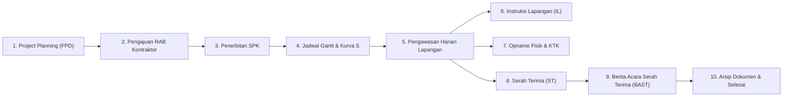

# Dokumentasi Master: Seluruh Alur Kerja Sistem SPARTA

Dokumen ini adalah **Katalog & Master Hub Seluruh Alur Kerja Sistem (System Workflows)** untuk aplikasi **SPARTA** (PT Sumber Alfaria Trijaya Tbk). Dokumen ini memetakan siklus hidup lengkap pekerjaan konstruksi mulai dari inisiasi proyek toko baru/renovasi, tender, pengawasan lapangan, serah terima, hingga arsip pasca-konstruksi.

---

## 1. Peta Siklus Hidup Konstruksi Toko (End-to-End Lifecycle)

---

## 2. Direktori & Matriks Alur Kerja Sistem

Setiap modul memiliki alur kerja spesifik, dokumen referensi detail, aktor utama, serta aturan bisnis:

| No | Modul / Alur Kerja | Rute Halaman | Aktor Utama | Status Dokumen | Tautan Dokumen Detail |
| :---: | :--- | :--- | :--- | :---: | :--- |
| **01** | **Project Planning (FPD)** | `/projek-planning` | Cabang, Location, Design Specialist, BBMM | Siap | *Menampung FPD, approval bertingkat, & checklist upload RAB* |
| **02** | **Penawaran & Evaluasi RAB** | `/rab`, `/ubah-rab-item` | Estimator, Kontraktor, Koordinator Bangunan | Siap | *Perhitungan item sipil/ME, evaluasi harga satuan, approval final* |
| **03** | **Surat Perintah Kerja (SPK)** | `/spk`, `/tambahspk` | BBMM, Branch Manager, Kontraktor | Siap | *Penerbitan SPK, addendum perpanjangan waktu, policy backdate* |
| **04** | **Jadwal & Kurva S Proyek** | `/gantt` | PIC Pengawas, Koordinator Bangunan, Kontraktor | Siap | *Timeline harian, perhitungan bobot deviasi, grafik Kurva S* |
| **05** | **Pengawasan Harian Lapangan** | `/gantt`, `/inputpic` | PIC Pengawas Lapangan, Kontraktor | Siap | *Pemeriksaan harian checkpoint, carry-over pekerjaan belum selesai* |
| **06** | **Instruksi Lapangan (IL)** | `/instruksi-lapangan` | Pengawas Lapangan, Koordinator Bangunan | Siap | *Perintah pekerjaan tambah/kurang di lapangan, migrasi RAB 2* |
| **07** | **Opname Fisik & KTK** | `/opname` | Tim Building Cabang, Kontraktor | Siap | *Pemeriksaan fisik progres termin parsial & Final KTK toko* |
| **08** | **Serah Terima (ST)** | `/gantt` (Milestone ST) | Pengawas, Koordinator Bangunan, Kontraktor | **Lengkap** | [Lihat Dokumen Alur Kerja ST](./workflows/alur-kerja-serah-terima-st.md) |
| **09** | **BAST (Berita Acara)** | `/serah-terima` | BBMM, Branch Manager, Kontraktor | Siap | *Penerbitan BAST resmi, sinkronisasi tanggal BAST* |
| **10** | **Dokumentasi & 12 Dokumen** | `/ftdokumen`, `/svdokumen` | Kontraktor, Admin Toko | Siap | *Foto fisik lapangan (kompresi client), arsip 12 dokumen perizinan* |
| **11** | **Surat Peringatan & Denda** | `/surat-peringatan` | BBMM, Koordinator Bangunan | Siap | *SP 1, SP 2, SP 3 deviasi Kurva S, kalkulasi denda keterlambatan* |
| **12** | **Konstruksi Gudang (DC)** | `/dc-development` | Tim DC Development, Konsultan MK, Kontraktor DC | Siap | *Tender peserta DC, termin pembayaran, BAST DC* |

---

## 3. Ringkasan Setiap Alur Kerja

### 01. Alur Project Planning (FPD)
- **Tujuan**: Mengajukan permintaan desain toko baru/renovasi berdasarkan data survei lokasi.
- **Rute**: [`/projek-planning`](file:///c:/Users/UDevran/Documents/Sumber%20Alfaria Trijaya/system/sparta-fe/app/projek-planning/page.tsx)
- **Tahapan**:
  1. Input data toko (Cabang, Nama Toko, Tipe Toko, Luas Bangunan, dsb.).
  2. Upload denah layout lokasi.
  3. Approval berjenjang (Location Specialist → Design Specialist → BBMM).
  4. Validasi Checklist Upload RAB: Sebelum submit, sistem memvalidasi kelengkapan dokumen pendukung.

### 02. Alur Penawaran & Evaluasi RAB
- **Tujuan**: Menentukan rincian anggaran biaya pekerjaan fisik toko (Sipil & ME).
- **Rute**: [`/rab`](file:///c:/Users/UDevran/Documents/Sumber%20Alfaria Trijaya/system/sparta-fe/app/rab/page.tsx)
- **Tahapan**:
  1. Kontraktor mengunggah rincian volume dan harga satuan.
  2. Sistem menghitung rekapitulasi sub-total Sipil & ME.
  3. Tim Estimator/Building Cabang mereview dan menyetujui penawaran final.

### 03. Alur Surat Perintah Kerja (SPK) & Addendum
- **Tujuan**: Mengikat kontrak legal pelaksanaan proyek antara Alfamart dan Kontraktor.
- **Rute**: [`/spk`](file:///c:/Users/UDevran/Documents/Sumber%20Alfaria Trijaya/system/sparta-fe/app/spk/page.tsx), [`/tambahspk`](file:///c:/Users/UDevran/Documents/Sumber%20Alfaria Trijaya/system/sparta-fe/app/tambahspk/page.tsx)
- **Tahapan**:
  1. Penerbitan nomor SPK berdasarkan RAB yang telah disetujui.
  2. Penentuan tanggal mulai dan target selesai (durasi kerja standar, misal 30/45 hari).
  3. Jika terjadi kendala cuaca/lapangan yang disetujui, kontraktor dapat mengajukan **Tambah Hari SPK** (Addendum).

### 04 & 05. Alur Jadwal Gantt, Kurva S, & Pengawasan Harian
- **Tujuan**: Memonitor progres fisik harian, deviasi target vs realisasi, dan checklist mutu pekerjaan.
- **Rute**: [`/gantt`](file:///c:/Users/UDevran/Documents/Sumber%20Alfaria Trijaya/system/sparta-fe/app/gantt/page.tsx)
- **Tahapan**:
  1. Timeline dibuat otomatis berdasarkan rincian bobot item RAB.
  2. Setiap tanggal checkpoint pengawasan, pengawas mengisi status item: `Belum`, `Proses`, `Selesai`, atau `Terlambat`.
  3. Item yang belum selesai pada tanggal sebelumnya akan otomatis dibawa (*carry-over*) ke checkpoint pengawasan berikutnya.
  4. Grafik Kurva S terupdate secara real-time menampilkan deviasi minus atau plus.

### 06. Alur Instruksi Lapangan (IL)
- **Tujuan**: Mencatat pekerjaan tambah atau kurang yang ditemukan mendadak di lapangan.
- **Rute**: [`/instruksi-lapangan`](file:///c:/Users/UDevran/Documents/Sumber%20Alfaria Trijaya/system/sparta-fe/app/instruksi-lapangan/page.tsx)
- **Tahapan**:
  1. Pengawas menerbitkan formulir Instruksi Lapangan resmi.
  2. Diverifikasi oleh Koordinator Bangunan.
  3. Item pekerjaan tambahan terintegrasi ke dalam pengawasan Gantt Chart.

### 07. Alur Opname Fisik & KTK
- **Tujuan**: Menghitung progres persentase fisik sebenarnya untuk dasar pencairan termin pembayaran kontraktor.
- **Rute**: [`/opname`](file:///c:/Users/UDevran/Documents/Sumber%20Alfaria Trijaya/system/sparta-fe/app/opname/page.tsx)
- **Tahapan**:
  1. Opname Parsial (Termin 1, Termin 2, dsb.).
  2. Final Opname KTK (Koreksi Tagihan Kontraktor) sebelum serah terima.

### 08. Alur Serah Terima (ST)
- **Tujuan**: Penyerahan fisik bangunan toko setelah 100% item pekerjaan diselesaikan.
- **Rute**: [`/gantt`](file:///c:/Users/UDevran/Documents/Sumber%20Alfaria Trijaya/system/sparta-fe/app/gantt/page.tsx) (Kolom Tanggal ST)
- **Dokumentasi Lengkap**: 👉 **[Baca Panduan Alur Kerja Serah Terima (ST) Lengkap](./workflows/alur-kerja-serah-terima-st.md)**
- **Inti Aturan**:
  - Validasi Lintas Lingkup (SIPIL dan ME).
  - Wajib menyelesaikan semua item yang menggantung/terlambat dari riwayat sebelumnya.
  - Dialog peringatan otomatis memandu pengawas antar-lingkup pekerjaan.

### 09. Alur Berita Acara Serah Terima (BAST)
- **Tujuan**: Penerbitan dokumen legal BAST resmi yang ditandatangani Branch Manager dan Kontraktor.
- **Rute**: [`/serah-terima`](file:///c:/Users/UDevran/Documents/Sumber%20Alfaria Trijaya/system/sparta-fe/app/serah-terima/page.tsx)
- **Tahapan**:
  1. Menarik data hasil Serah Terima fisik dari Gantt Chart.
  2. Generate format cetak BAST toko standar SAT.
  3. Sinkronisasi tanggal dan penutupan status proyek menjadi selesai.

### 10. Alur Dokumentasi & Arsip Dokumen Toko
- **Tujuan**: Menjamin kelengkapan fisik bukti visual dan perizinan toko.
- **Rute**: [`/ftdokumen`](file:///c:/Users/UDevran/Documents/Sumber%20Alfaria Trijaya/system/sparta-fe/app/ftdokumen/page.tsx), [`/svdokumen`](file:///c:/Users/UDevran/Documents/Sumber%20Alfaria Trijaya/system/sparta-fe/app/svdokumen/page.tsx)
- **Tahapan**:
  1. Upload foto progres fisik (terkompresi otomatis di browser < 300KB).
  2. Verifikasi 12 dokumen perizinan wajib toko (IMB/PBG, Sertifikat Laik Fungsi, Izin Reklame, dsb.).

### 11. Alur Surat Peringatan (SP) & Denda
- **Tujuan**: Penegakan disiplin waktu kontrak kontraktor jika terjadi deviasi keterlambatan.
- **Rute**: [`/surat-peringatan`](file:///c:/Users/UDevran/Documents/Sumber%20Alfaria Trijaya/system/sparta-fe/app/surat-peringatan/page.tsx)
- **Tahapan**:
  1. Deviasi Kurva S melebihi batas toleransi memicu status peringatan (SP 1, SP 2, SP 3).
  2. Sistem menghitung denda keterlambatan harian (per mil) secara otomatis.

### 12. Alur Workspace DC Development
- **Tujuan**: Penanganan proyek skala besar pembangunan gudang Distribution Center.
- **Rute**: [`/dc-development`](file:///c:/Users/UDevran/Documents/Sumber%20Alfaria Trijaya/system/sparta-fe/app/dc-development/page.tsx)
- **Tahapan**:
  1. Seleksi & Evaluasi Tender Peserta DC.
  2. Pengawasan oleh Konsultan MK (Manajemen Konstruksi).
  3. Pengajuan Termin Pembayaran Berkala & BAST DC.

---

## 4. Panduan Menambah Dokumentasi Alur Kerja Baru

Untuk menambahkan dokumen alur kerja modul lain di masa mendatang:
1. Buat file baru di direktori `sparta-fe/docs/workflows/alur-kerja-<nama-modul>.md`.
2. Format dokumen wajib mengikuti standar struktur:
   - **Ringkasan & Definisi**: Aktor, rute URL, prasyarat.
   - **Diagram Alur (Mermaid)**: Visualisasi langkah proses.
   - **Aturan Bisnis (Business Rules)**: Validasi dan batasan sistem.
   - **Panduan Pengguna (Step-by-Step)**: Langkah operasional antarmuka.
   - **Troubleshooting**: Masalah umum dan solusi.
   - **Referensi Kode**: File frontend/backend yang relevan.
3. Daftarkan tautan file baru tersebut pada tabel di dokumen master ini (`sparta-fe/docs/alur-kerja-sistem.md`).
