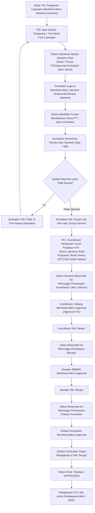

# Alur Kerja Opname (Kerja Tambah Kurang / KTK) & Approval Kontraktor

Dokumen ini menjelaskan spesifikasi lengkap, tata aturan bisnis, alur transisi status persetujuan (*approval state transition*), panduan operasional antarmuka, serta penanganan kasus teknis (*troubleshooting*) untuk proses **Opname Fisik Lapangan & Evaluasi KTK (Koreksi Tagihan Kontraktor)** pada aplikasi **SPARTA** (PT Sumber Alfaria Trijaya Tbk).

---

## 1. Ringkasan & Definisi

| Entitas | Penjelasan |
| :--- | :--- |
| **Definisi Opname** | Pemeriksaan fisik lapangan atas kuantitas/volume pekerjaan yang terpasang dibandingkan dengan volume rencana pada dokumen RAB (Rencana Anggaran Biaya). |
| **Definisi KTK** | Koreksi Tagihan Kontraktor (evaluasi kerja tambah atau kerja kurang) sebelum pembayaran final diproses. |
| **Dual Antarmuka** | 1. **Menu Review Opname (`/opname`)**: Tempat kontraktor lapangan memeriksa foto dan menyetujui/menolak item fisik satuan. 2. **Menu Approval KTK (`/approval`)**: Tempat pejabat struktural (Koordinator, Manajer, Direktur Kontraktor) menandatangani rekapitulasi KTK resmi. |
| **Aktor Terlibat** | **PIC Pengawas Lapangan**, **Kontraktor Lapangan**, **Branch Building Coordinator**, **Branch Building & Maintenance Manager (BBMM)**, **Direktur Kontraktor**. |
| **Karakteristik Multi-Lingkup** | Proyek toko Alfamart memiliki data terpisah antara lingkup **SIPIL** dan **ME (Mekanikal & Elektrikal)**, dengan `id_toko` dan rekanan kontraktor yang independen. |

---

## 2. Diagram Alur Kerja (Workflow Diagram)

---

## 3. Tahapan & Transisi Status Approval (State Machine)

Siklus Opname Final di SPARTA berjalan melalui **6 tahapan status** yang saling mengunci (*strict sequential transitions*):

| Tahap | Status Opname Final | Aksi Database | Aktor yang Berwenang | Halaman Aplikasi | Keterangan |
| :---: | :--- | :---: | :--- | :--- | :--- |
| **1** | `Proses KTK/Approval Kontraktor` | `active` | PIC Pengawas Lapangan | `/opname` | Data opname diisi pertama kali oleh PIC pengawas lapangan. |
| **2** | `Proses KTK/Approval Kontraktor` | `active` | Kontraktor Lapangan | `/opname` (Review Mode) | Kontraktor mereview item satu per satu dan menyetujui volume fisik. |
| **3** | `Menunggu Persetujuan Koordinator` | `terkunci` | PIC / Koordinator | `/opname` (Kunci KTK) | Tombol Kunci ditekan. PDF otomatis di-generate dan diunggah ke Google Drive. |
| **4** | `Menunggu Persetujuan Manajer` | `terkunci` | Branch Building Coordinator | `/approval` | Koordinator menyetujui rekapitulasi KTK setelah memeriksa angka deviasi. |
| **5** | `Menunggu Persetujuan Direktur Kontraktor` | `terkunci` | Branch Building & Maintenance Manager (BBMM) | `/approval` | Manajer cabang menyetujui, meneruskan ke pimpinan kontraktor rekanan. |
| **6** | `Disetujui` *(APPROVED)* | `terkunci` | Direktur Kontraktor | `/approval` | Tanda tangan digital/approval final kontraktor. KTK resmi sah. |

> [!NOTE]
> Pengecualian Cabang **BATAM**: Pada cabang Batam, setelah persetujuan Koordinator, alur langsung melompat ke `Menunggu Persetujuan Direktur Kontraktor` (melewati Manajer) sesuai matriks desentralisasi cabang khusus.

---

## 4. Aturan Bisnis & Integritas Data (Business Rules)

### Rule 1: Pemisahan Akses Antarmuka Kontraktor
- **Role `KONTRAKTOR` murni**: Tidak mengakses menu `/approval`. Kontraktor bertugas di lapangan dan menyetujui item volume fisik di menu **`/opname` (Review Opname)**.
- **Role `DIREKTUR KONTRAKTOR`**: Memiliki akses ke menu **`/approval`** untuk menandatangani dokumen final pada Tahap 6 (`Menunggu Persetujuan Direktur Kontraktor`).

### Rule 2: Multi-Scope Proyek Toko (SIPIL vs ME)
- Setiap nomor ULOK toko memiliki minimal dua rekaman entitas pada tabel `toko`:
  - `lingkup_pekerjaan = 'SIPIL'` (`id_toko` unik untuk Sipil).
  - `lingkup_pekerjaan = 'ME'` (`id_toko` unik untuk ME).
- Dokumen SPK, RAB, kurva Gantt, dan Opname Final terpisah untuk masing-masing lingkup.
- Kontraktor yang mengerjakan Sipil dan ME bisa berbeda perusahaan atau perusahaan yang sama dengan dua penugasan terpisah.

### Rule 3: Validasi Kepemilikan Proyek Kontraktor (`matchesUserCompany`)
- Untuk alasan keamanan data, kontraktor hanya diperbolehkan melihat proyek milik perusahaannya sendiri.
- Penyaringan proyek dilakukan dengan mencocokkan `userInfo.nama_pt` terhadap nama kontraktor pada RAB, SPK, dan data Toko.
- Normalisasi teks membuang imbuhan bentuk badan usaha (`PT`, `CV`), titik, koma, serta spasi berlebih.

### Rule 4: Prasyarat Kunci Finalisasi KTK (`hasSerahTerima`)
- Tombol **Kunci Finalisasi KTK** hanya dapat diproses apabila:
  1. Pengawasan fisik telah tuntas 100%.
  2. Berkas Serah Terima (ST) fisik pada tabel `berkas_serah_terima` telah tercatat.
- Jika ST belum dilakukan, sistem akan menolak dengan pesan:
  > *"Tidak dapat melakukan Kunci Finalisasi KTK. Pastikan Pengawasan sudah terisi penuh dan Serah Terima sudah dilakukan."*

---

## 5. Panduan Operasional Pengguna (Step-by-Step User Guide)

### Langkah Kontraktor Lapangan (Review Opname di `/opname`):
1. Kontraktor login menggunakan akun rekanan (misal: `sumberrejekicv524@gmail.com`).
2. Masuk ke menu **Opname** (`/opname`). Sistem otomatis mengarahkan ke antarmuka **Review Opname**.
3. Di panel kiri, cari dan klik nama toko yang ditugaskan (tersedia filter cabang dan kolom pencarian).
4. Daftar seluruh item pekerjaan akan tampil dikelompokkan per kategori pekerjaan.
5. Periksa volume RAB awal vs volume realisasi fisik yang diajukan pengawas lapangan, beserta link foto terlampir.
6. Klik tombol hijau **Setujui** per item, atau gunakan tombol **Setujui Semua Item** jika seluruh data telah diverifikasi cocok.

### Langkah Koordinator / Pengawas (Kunci Finalisasi KTK):
1. Setelah seluruh item opname disetujui kontraktor, buka toko tersebut di menu Opname PIC.
2. Klik tombol **Kunci Finalisasi KTK**.
3. Sistem memvalidasi kelengkapan Serah Terima, menghitung rekapitulasi denda dan selisih nilai, membuat dokumen PDF resmi, lalu mengubah status ke `Menunggu Persetujuan Koordinator`.

### Langkah Pejabat Struktural & Direktur Kontraktor di `/approval`:
1. Buka menu **Approval Center** (`/approval`).
2. Pilih kartu **Approval Kerja Tambah Kurang (OPNAME)**.
3. Klik tombol aksi **Tinjau** pada baris toko yang menunggu persetujuan.
4. Periksa ringkasan total nilai RAB, total nilai Opname, deviasi penambahan/pengurangan, serta rincian denda jika ada.
5. Klik **Setujui** untuk memajukan status ke tahap berikutnya hingga final (`Disetujui`).

---

## 6. Kasus Nyata & Solusi (Kasus Prembun Cilacap)

### Kasus: "Prembun Cilacap Approval Opname ME tidak muncul di kontraktor"
- **Nomor ULOK**: `IZ01-2604-I021-R`
- **Cabang**: `CILACAP`
- **Toko**: `PREMBUN`

#### Temuan Diagnostik:
1. **Perbedaan Penulisan Nama Rekanan (J vs Z)**:
   - Toko Sipil (`id_toko: 1482`): Rekanan tertulis `CV SUMBER REJEKI` (huruf **J**). Status Opname Final sudah selesai (`Disetujui`).
   - Toko ME (`id_toko: 1182`): Rekanan pada RAB dan SPK tertulis `CV SUMBER REZEKI` (huruf **Z**).
   - Akun Pengguna Kontraktor (`sumberrejekicv524@gmail.com`): Terdaftar dengan `nama_pt = "CV SUMBER REJEKI"` (huruf **J**).
2. **Akibat di Halaman `/opname`**:
   Filter frontend di `app/opname/page.tsx` membandingkan string kaku `"SUMBERREZEKI"` dengan `"SUMBERREJEKI"`. Karena tidak cocok dan tidak mengecek fallback email, data toko ME Prembun langsung tereliminasi dari daftar proyek kontraktor tersebut.
3. **Akibat di Halaman `/approval`**:
   Data ME Prembun saat ini masih berada di Tahap 2 (`Proses KTK/Approval Kontraktor`), belum dikunci ke Tahap 6 (`Menunggu Persetujuan Direktur Kontraktor`). Oleh karena itu, item tersebut memang belum saatnya masuk ke daftar approval direktur.

#### Rekomendasi Penanganan:
- **Penyelarasan Data**: Koreksi penulisan nama kontraktor pada data ME Prembun agar seragam menggunakan huruf **J** (`CV SUMBER REJEKI`).
- **Penyempurnaan Kode Frontend**: Menambahkan pengecekan fallback berbasis email pembuat (`item.email_pembuat === userEmail`) dan normalisasi kesetaraan fonetik huruf `J` dan `Z` pada modul penyaring perusahaan rekanan.

---

## 7. Referensi File & Kode Sumber

- **Review Opname Kontraktor**: [`sparta-fe/app/opname/page.tsx`](file:///c:/Users/UDevran/Documents/Sumber%20Alfaria%20Trijaya/system/sparta-fe/app/opname/page.tsx)
  - Komponen: `KontraktorOpnameView` (L1576-L1950)
  - Logika Filter Kepemilikan Toko: L1640-L1658
- **Approval Center Terpadu**: [`sparta-fe/app/approval/page.tsx`](file:///c:/Users/UDevran/Documents/Sumber%20Alfaria%20Trijaya/system/sparta-fe/app/approval/page.tsx)
  - Logika Status Bertingkat: `isPendingApprovalStatus`, `matchesApprovalStage` (L327-L368)
  - Filter Perusahaan Rekanan: `matchesUserCompany` (L370-L415)
- **Backend Service Opname Final**: [`sparta-be/src/modules/opname-final/opname-final.service.ts`](file:///c:/Users/UDevran/Documents/Sumber%20Alfaria%20Trijaya/system/sparta-be/src/modules/opname-final/opname-final.service.ts)
  - Transisi Status: `resolveStatusTransition` (L86-L140)
  - Kunci KTK: `lockOpnameFinal` (L640-L680)
- **Konstanta Status**: [`sparta-be/src/modules/opname-final/opname-final.constants.ts`](file:///c:/Users/UDevran/Documents/Sumber%20Alfaria%20Trijaya/system/sparta-be/src/modules/opname-final/opname-final.constants.ts)
