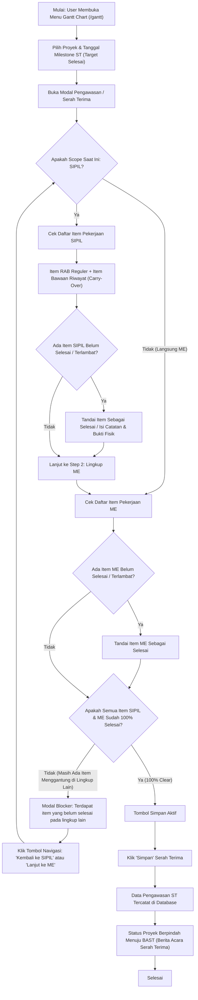

# Alur Kerja Serah Terima (ST) & Validasi Pengawasan Lapangan

Dokumen ini menjelaskan spesifikasi lengkap, tata aturan bisnis, tata cara operasional pengguna (*user journey*), dan penanganan kasus teknis (*troubleshooting*) untuk proses **Serah Terima (ST)** serta pengawasan harian proyek pada aplikasi **SPARTA** (PT Sumber Alfaria Trijaya Tbk).

---

## 1. Ringkasan & Definisi

| Entitas | Penjelasan |
| :--- | :--- |
| **Definisi ST** | Milestone serah terima fisik bangunan toko/proyek dari pihak Kontraktor kepada pihak Alfamart (Tim Building / Cabang). |
| **Rute Antarmuka** | `sparta-fe/app/gantt/page.tsx` (Trigger modal pengawasan/ST pada jadwal Gantt Chart) dan `sparta-fe/app/serah-terima/` (Penerbitan BAST Toko). |
| **Aktor Terlibat** | **Kontraktor Lapangan**, **PIC Pengawas Cabang (Civil/ME Specialist)**, **Koordinator Bangunan Cabang**, **Branch Building Maintenance Manager (BBMM)**. |
| **Multi-Lingkup** | Proyek toko Alfamart selalu terbagi menjadi minimal 2 lingkup pekerjaan: **SIPIL** dan **ME (Mekanikal & Elektrikal)**. |
| **Prasyarat Utama** | Seluruh item pekerjaan (baik item RAB utama, instruksi lapangan, maupun pekerjaan tambahan) dari seluruh tanggal pengawasan sebelumnya **harus berstatus Selesai** (tidak boleh ada yang menggantung, belum diisi, atau berstatus Terlambat). |

---

## 2. Diagram Alur Kerja (Workflow Diagram)

---

## 3. Aturan Bisnis & Integritas Data (Business Rules)

### Rule 1: Validasi Lintas Lingkup (Cross-Scope Validation)
- Serah Terima merupakan gerbang akhir konstruksi. Proyek tidak boleh dinyatakan serah terima jika salah satu lingkup (misal ME) sudah tuntas tetapi lingkup pasangannya (SIPIL) masih memiliki pekerjaan tertunda.
- Sistem menerapkan validasi dua arah:
  - Saat berada di lingkup SIPIL: Sistem memeriksa apakah ada item pending di lingkup ME.
  - Saat berada di lingkup ME: Sistem memeriksa apakah ada item pending di lingkup SIPIL.
- Jika terdapat item pending pada lingkup lain, tombol **Simpan** akan diblokir dengan pesan peringatan:
  > *"Terdapat item pengawasan yang belum selesai pada lingkup pekerjaan lain. Silakan ubah lingkup pekerjaan untuk melihat dan mengisi item tersebut."*
  > Disertai tombol navigasi langsung: `[ ← Kembali ke SIPIL ]` atau `[ Pindah ke ME → ]`.

### Rule 2: Akumulasi Pekerjaan Terlambat / Carry-Over (`forcedStItems`)
- Setiap pekerjaan yang berstatus **Terlambat** atau **Belum Diisi** pada checkpoint tanggal pengawasan sebelumnya (misalnya pekerjaan di tanggal `12/10/2026`) secara otomatis wajib **dibawa ke tanggal pengawasan berikutnya hingga tanggal ST** (`16/10/2026`).
- Item bawaan ini ditandai dengan badge khusus: `Dari Riwayat` berwarna merah/abu-abu terang.
- Pekerjaan bawaan ini tidak boleh hilang dari daftar checkpoint tanggal selanjutnya sebelum pengawas menandainya menjadi `Selesai`.

### Rule 3: Integritas Pekerjaan Tambahan / Non-RAB
- Pekerjaan yang berasal dari Instruksi Lapangan (IL) atau Pekerjaan Tambahan yang tidak tercantum dalam master kategori RAB baku tetap diikutsertakan ke dalam akumulasi pemeriksaan akhir (*blocker validation*).
- Jika pada riwayat tanggal sebelumnya pekerjaan tambahan tersebut ditandai `Terlambat`, maka pada modal ST tanggal serah terima pekerjaan tersebut otomatis dimunculkan kembali agar pengawas dapat mengubah statusnya menjadi `Selesai`.

---

## 4. Panduan Operasional Pengguna (Step-by-Step User Guide)

### Langkah 1: Akses Menu Jadwal Proyek
1. Buka navigasi utama SPARTA lalu pilih menu **Gantt Chart & Kurva S** (`/gantt`).
2. Gunakan filter toko/proyek (pilih Cabang dan Nomor SPK / Nama Toko yang ingin diperiksa).
3. Tabel jadwal proyek dan Kurva S akan ditampilkan.

### Langkah 2: Menuju Tanggal Target Serah Terima (ST)
1. Perhatikan kolom tanggal pada tabel Gantt. Cari kolom bertanda khusus **ST** (biasanya berada pada tanggal akhir rencana kerja proyek, contoh: `16/10/2026`).
2. Klik sel atau tanggal ST tersebut untuk membuka formulir **Memo Pengawasan / Serah Terima**.

### Langkah 3: Mengisi / Menyelesaikan Lingkup SIPIL (Langkah 1 dari 2)
1. Perhatikan header modal: `Langkah 1 dari 2` dengan badge `SIPIL`.
2. Periksa semua kategori pekerjaan sipil:
   - Item RAB Utama (Pondasi, Dinding, Lantai, Cat, dsb.).
   - Item Riwayat / Tambahan (bertanda `Dari Riwayat`).
3. Pastikan tidak ada item yang bertanda merah `Terlambat` atau `Belum`.
4. Ubah status item yang telah rampung menjadi `Selesai`.
5. Klik tombol di kanan bawah: **"Lanjut ke ME"**.

### Langkah 4: Mengisi / Menyelesaikan Lingkup ME (Langkah 2 dari 2)
1. Header modal berpindah ke: `Langkah 2 dari 2` dengan badge `ME`.
2. Periksa seluruh item mekanikal & elektrikal (Instalasi Listrik, Panel, Lampu, AC, Plumbing, dsb.).
3. Pastikan seluruh item ME telah tuntas dan berstatus `Selesai`.

### Langkah 5: Finalisasi & Simpan Serah Terima
1. Jika kedua lingkup (SIPIL dan ME) telah 100% selesai:
   - Layar blocker tidak akan muncul.
   - Tombol **Simpan** di pojok kanan bawah berwarna biru aktif.
2. Klik tombol **Simpan**.
3. Sistem akan memvalidasi payload dan menyimpan status serah terima ke server database.
4. Muncul notifikasi sukses: *"Data pengawasan dan Serah Terima berhasil disimpan"*.
5. Proyek kini siap diproses ke modul **Berita Acara Serah Terima (BAST)**.

---

## 5. Troubleshooting & Solusi Kendala Pengguna

### Kasus A: "Muncul tulisan 'Terdapat item pengawasan yang belum selesai pada lingkup pekerjaan lain. Silakan ubah lingkup pekerjaan di kiri atas...'"
- **Penyebab**: Pengguna sedang membuka modal Serah Terima di lingkup ME, namun di lingkup SIPIL masih ada 1 atau lebih item pekerjaan yang belum berstatus `Selesai` (atau sebaliknya).
- **Solusi**:
  1. Klik tombol **`Kembali ke SIPIL`** yang tersedia di pojok kanan bawah dialog.
  2. Cari item yang berstatus merah (`Terlambat` atau `Belum Selesai`).
  3. Tandai item tersebut menjadi `Selesai`.
  4. Klik kembali tombol **`Lanjut ke ME`**, lalu klik **`Simpan`**.

### Kasus B: "Di tanggal 12 ada pekerjaan terlambat (Pekerjaan Tambahan), tapi tidak bisa diisi lagi di tanggal berikutnya"
- **Penyebab**: Checkpoint tanggal sebelumnya (misal tgl 12) sudah terkunci/tersimpan sebagai data histori, dan tanggal antara 12 s.d. 16 belum pernah dibuka atau disimpan, sehingga filter tanggal terdekat menganggap item tersebut tidak dapat diedit sebelum tanggal ST.
- **Solusi Sistem (Perbaikan Kode)**:
  - Logika `isNearestPengawasanAfter` telah diperbaiki agar selalu mengizinkan pengisian pada tanggal-tanggal setelah checkpoint terakhir meskipun belum ada data checkpoint tersimpan di database.
  - Logika `forcedStItems` dan `validForcedStBlockerItems` pada `app/gantt/page.tsx` telah diselaraskan agar seluruh pekerjaan tambahan non-RAB yang belum selesai pada tanggal sebelumnya otomatis ditarik dan disajikan di modal Serah Terima untuk diselesaikan.

### Kasus C: "Pekerjaan Tambahan (Dari Riwayat) dipilih 'Selesai', tapi formulir Opname Parsial tidak muncul & gagal Simpan karena data belum lengkap"
- **Penyebab**: Fungsi `findWorkItemForMemo` secara bawaan mencari data acuan harga dan volume di `rabItems`. Karena item histori/pekerjaan tambahan berasal dari catatan pengawasan terdahulu (`source_type === 'HISTORY'`) dan bukan item master RAB, pencarian ke `rabItems` menghasilkan `null`. Akibatnya, `renderOpnameForm()` mengembalikan `null` (form opname tersembunyi), sehingga pengguna tidak dapat mengisi kesesuaian desain, kualitas, spesifikasi, dan foto opname. Saat tombol **Simpan** diklik, validasi memblokir penyimpanan karena data opname wajib diisi untuk status `Selesai`.
- **Solusi Sistem (Perbaikan Kode)**:
  - Memperbarui `findWorkItemForMemo` di `app/gantt/page.tsx` agar memiliki mekanisme *fallback* ke `currentItem` ketika item tidak ditemukan di daftar RAB (menggunakan volume bawaan, satuan `Ls`, dan harga 0).
  - Formulir Opname & Verifikasi Pekerjaan kini muncul seketika saat tombol status `Selesai` dipilih pada item riwayat pengawasan.
  - Pengamanan ID Opname (`safeRabId` dan `safeIlId`): Nilai ID non-numerik (seperti ID string sintesis `forced-st-...`) dinormalisasi menjadi `undefined` agar tidak menghasilkan `NaN` pada payload dan mematuhi skema backend Zod.

---

## 6. Referensi File & Kode Sumber

- **Komponen Utama Gantt & Dialog ST**: [`sparta-fe/app/gantt/page.tsx`](file:///c:/Users/UDevran/Documents/Sumber%20Alfaria%20Trijaya/system/sparta-fe/app/gantt/page.tsx)
  - Logika Carry-Over: Variabel `latestUnfinishedRows` & `forcedStItems`.
  - Logika Blocker Antar-Lingkup: Pengecekan `unfinishedInOtherScope`.
  - Tombol Navigasi Lingkup: Dialog blocker yang menyertakan tombol aksi balik langsung.
- **Modul BAST**: [`sparta-fe/app/serah-terima/`](file:///c:/Users/UDevran/Documents/Sumber%20Alfaria%20Trijaya/system/sparta-fe/app/serah-terima)
- **Komponen Gantt Viewer**: [`sparta-fe/components/GanttViewer.tsx`](file:///c:/Users/UDevran/Documents/Sumber%20Alfaria%20Trijaya/system/sparta-fe/components/GanttViewer.tsx)
- **Komponen Unified Supervision Gantt**: [`sparta-fe/components/UnifiedSupervisionGantt.tsx`](file:///c:/Users/UDevran/Documents/Sumber%20Alfaria%20Trijaya/system/sparta-fe/components/UnifiedSupervisionGantt.tsx)
